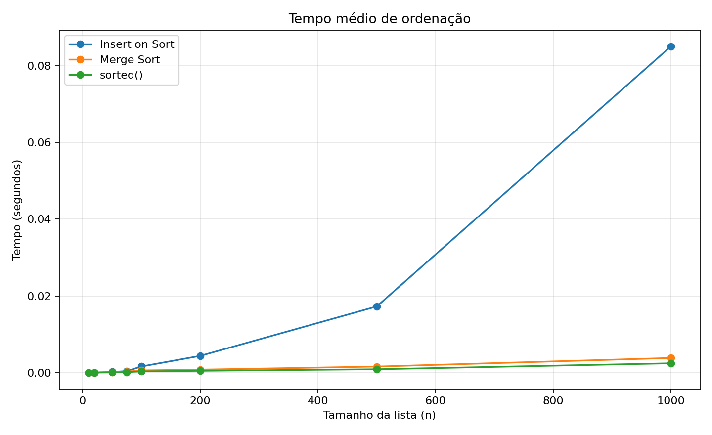
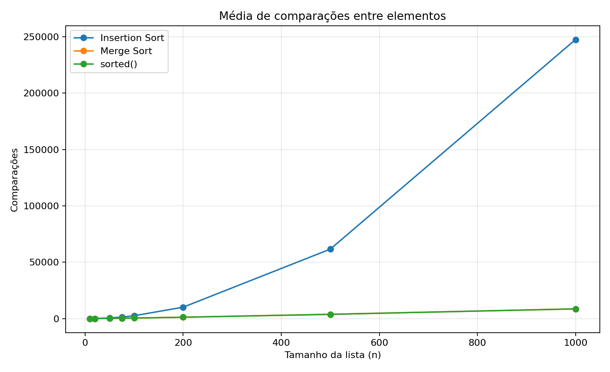

# Relatório — comparação de algoritmos de ordenação

## Objetivo

O objetivo deste trabalho foi implementar os algoritmos Insertion Sort e Merge Sort, testar seu funcionamento e comparar o desempenho dos dois com a função `sorted()` do Python. Foram medidos o tempo de execução e a quantidade de comparações para listas de diferentes tamanhos.

## Metodologia

Foram usados os tamanhos de lista 10, 20, 50, 75, 100, 200, 500 e 1000. Para cada tamanho, foram feitas 10 repetições com listas de números inteiros geradas aleatoriamente. A mesma lista foi usada pelos três métodos em cada repetição. O tempo foi medido com `time.perf_counter()` e foi calculada a média das 10 execuções.

A contagem de comparações foi feita com uma classe que encapsula cada número e incrementa um contador quando os algoritmos comparam valores. Essa instrumentação adiciona algum custo, portanto os tempos servem principalmente para comparar os métodos dentro deste mesmo experimento. A função `sorted()` foi executada sobre os mesmos valores encapsulados para permitir a contagem das comparações.

## Resultados

A tabela apresenta as médias registradas na execução que acompanha este repositório. Os tempos estão em segundos.

| n | Insertion Sort (s) | Merge Sort (s) | sorted() (s) | Inserção (comparações) | Merge (comparações) | sorted() (comparações) |
|---:|---:|---:|---:|---:|---:|---:|
| 10 | 0.00001045 | 0.00001485 | 0.00000625 | 30.20 | 23.00 | 24.50 |
| 20 | 0.00002815 | 0.00002769 | 0.00001089 | 113.60 | 64.00 | 64.40 |
| 50 | 0.00016760 | 0.00010239 | 0.00004273 | 628.40 | 222.60 | 218.40 |
| 75 | 0.00039679 | 0.00025499 | 0.00013503 | 1439.60 | 377.20 | 372.80 |
| 100 | 0.00159866 | 0.00057318 | 0.00031266 | 2574.60 | 541.40 | 537.80 |
| 200 | 0.00436711 | 0.00077710 | 0.00047312 | 10174.80 | 1280.40 | 1272.10 |
| 500 | 0.01725686 | 0.00157791 | 0.00087668 | 61672.00 | 3853.90 | 3830.10 |
| 1000 | 0.08510936 | 0.00381602 | 0.00242850 | 247571.40 | 8707.70 | 8654.80 |

### Gráfico de tempos

### Gráfico de comparações

## Análise

O Insertion Sort é simples e costuma funcionar bem em listas pequenas ou que já estejam quase ordenadas. No entanto, no pior caso, quando a lista está em ordem inversa, seu número de operações cresce proporcionalmente a \(n^2\). Por isso, o tempo tende a aumentar bastante quando o tamanho da lista cresce.

O Merge Sort divide a lista em partes menores, ordena cada parte e depois intercala os resultados. Seu custo assintótico é \(O(n\log n)\), tanto em média quanto no pior caso. Assim, ele tende a escalar melhor para listas maiores, embora precise de memória auxiliar para combinar as partes.

A função `sorted()` normalmente é a mais rápida neste teste porque usa o Timsort, uma implementação otimizada em C que aproveita sequências já ordenadas e tem bom desempenho em dados reais. A contagem de comparações de `sorted()` não representa o número de comparações de pivô: o Timsort não é Quicksort e não usa pivôs.

## Comparação com o limite \(n\log n\)

O crescimento \(n\log n\) é uma referência útil para algoritmos eficientes de ordenação por comparação, como o Merge Sort. O Insertion Sort pode precisar de aproximadamente \(n(n-1)/2\) comparações no pior caso, enquanto o Merge Sort cresce na ordem de \(n\log n\). Os resultados medidos são experimentais e podem variar com a máquina, a versão do Python e os dados de entrada.

## Casos difíceis testados

Os testes incluem lista vazia, lista com um elemento, dois elementos em ambas as ordens, lista aleatória, lista já ordenada, lista invertida, elementos repetidos, valores negativos e uma lista maior invertida. Esses casos ajudam a encontrar erros de limites, tratamento de duplicatas e comportamento nas entradas extremas.

## Quando a inserção ainda seria uma escolha adequada?

A inserção pode ser adequada para listas pequenas, para dados que já estejam quase ordenados ou quando se deseja um algoritmo simples e que ordene a lista no próprio lugar. Para listas grandes e sem uma ordem prévia, o Merge Sort costuma ser uma opção mais previsível.

## Conclusão

O experimento demonstra que a escolha do algoritmo depende do tamanho e das características dos dados. O Insertion Sort é fácil de implementar e útil em casos pequenos, enquanto o Merge Sort oferece crescimento mais favorável para entradas grandes. Já `sorted()` combina um algoritmo altamente otimizado com uma implementação madura, sendo uma boa escolha padrão em Python. As medições, os testes e os gráficos permitem observar essas diferenças de forma prática.
